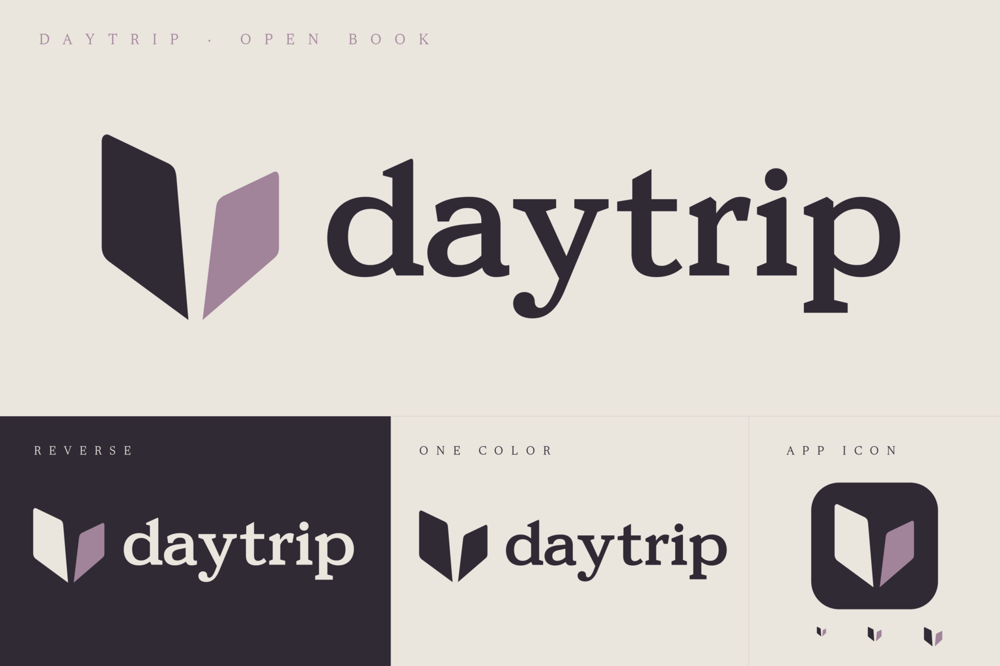

# daytrip · open book

The selected Daytrip identity pairs a lowercase editorial serif wordmark
with the original open-book symbol. Two asymmetrical paper leaves retain
their separate lower tips. The palette is limestone, plum ink, and muted
mauve. The logo has no tagline.



## Assets

| Use | Asset |
| --- | --- |
| Default logo on a light surface | [Horizontal signature](logos/lockup-horizontal.svg) |
| Logo on a dark surface | [Reverse signature](logos/lockup-horizontal-reverse.svg) |
| Symbol alone | [Open book](logos/open-book.svg), [reverse](logos/open-book-reverse.svg) |
| Name alone | [Outlined wordmark](logos/wordmark.svg), [reverse](logos/wordmark-reverse.svg) |
| One-color applications | [Ink](logos/lockup-horizontal-ink.svg), [paper](logos/lockup-horizontal-paper.svg) |
| Vertical placement | [Stacked signature](logos/lockup-stacked.svg), [reverse](logos/lockup-stacked-reverse.svg) |
| macOS app | [ICNS](icons/daytrip.icns), [unmasked square SVG](icons/daytrip-square.svg) |
| Windows app / favicon | [Multi-resolution ICO](icons/daytrip.ico) |
| Linux / general app icon | [Plated SVG](icons/daytrip-plated.svg), [PNG sizes](icons/png) |
| Large square artwork | [1024 px PNG](icons/daytrip-1024.png) |

Logo SVGs contain self-contained vector paths on a transparent background.
They require no fonts, external images, or network requests. Only the small
specimen labels in `preview.svg` use the viewer's fonts; the PNG specimen
uses the repository's bundled Newsreader for those labels.

## Palette and typography

[palette.json](palette.json) is the machine-readable source of truth.

| Color | Hex | Role |
| --- | --- | --- |
| Limestone | `#EAE5DD` | Light field; reverse lettering and left leaf |
| Plum ink | `#302A35` | Lettering and left leaf; dark field and icon plate |
| Muted mauve | `#A1839A` | Right leaf and restrained decorative emphasis |

Use plum on limestone and limestone on plum for text. Mauve is an accent,
not a default small-text color. In one-color artwork, both leaves use the
same ink and the central gap remains open.

The logo uses custom outlined editorial serif lettering.
The supplied paths and their spacing are the wordmark;
do not recreate it with a substitute typeface. Use lowercase `daytrip` in
the artwork and **Daytrip** in ordinary prose and application titles.

Supporting document typography uses the bundled Newsreader family, licensed
under the [SIL Open Font License](../../assets/fonts/OFL.txt). Interface
controls use the system sans serif; code and paths use system monospace.
Application themes extend this palette through semantic roles; see the
[Daytrip appearance system](../../docs/design-system.md). Custom theme and
document preferences remain independent of the fixed platform icon palette.

## Masters and reproduction

Edit the SVG masters in [sources](sources), then regenerate the exports:

- `open-book.svg` contains the approved asymmetrical book geometry.
- `open-book-compact.svg` widens the lower gap for 16–32 px icons.
- `wordmark.svg` contains the seven named, outlined letters of `daytrip`.

Preserve the aspect ratios, optical spacing, and symbol-to-name proportions.
Allow at least one quarter of the symbol height as clear space around a
standalone mark or signature. Start around 180 px wide for a horizontal
signature, or use the wordmark alone in a narrow placement. At 16–32 px,
use the compact symbol or the provided raster icons.

The square SVG and macOS iconset have an opaque plum square without a
baked-in platform mask. The plated SVG, general PNGs, and Windows ICO use
rounded plum plates with transparent corners. No shadow is baked in.
The app icon remains the book alone, independent of the wordmark.

PNG sizes are 16, 24, 32, 48, 64, 128, 256, 512, and 1024 px. The ICO
contains 16–256 px frames. The ICNS contains standard and Retina resources
up to 1024 px. Compact geometry is selected by actual raster dimensions.

The logo artwork follows the repository's [GPLv3-only license](../../LICENSE).
The separate Newsreader license applies to the font files.

## Regenerate and verify

Requirements: Python 3.9+ (standard library only) and ImageMagick 7
(`magick`). No application dependencies or macOS-only tools are required
to regenerate the kit.

```sh
python3 branding/daytrip/export.py
python3 branding/daytrip/export.py --check
```

`--check` regenerates in a temporary directory and compares every derived
SVG, PNG, ICO, ICNS, native vector paths, and preview byte for byte,
without overwriting the kit.
PNG timestamp metadata is stripped. To export elsewhere:

```sh
python3 branding/daytrip/export.py --output /tmp/daytrip-brand-export
```

The exporter explicitly uses ImageMagick's MSVG renderer and bundled
Newsreader for labels. Reference renderer: ImageMagick 7.1.2-31. Different
renderer versions may change raster bytes. Inspect `preview.png` and small
icons at their actual pixel dimensions after modifying the masters.

## Application integration

The application title, sidebar name, bundled writing samples, dialogs,
and export fallback titles use Daytrip. The sidebar draws the original
two-tone book and exact outlined wordmark using the active theme’s ink and decorative brand accent. Native Iced paths
in `native-paths.rs` are generated from the same SVG masters. The platform
icon uses the approved plum, limestone, and mauve artwork. The bundled PNG is decoded before
entering the UI event loop.

`scripts/bundle-macos.sh` builds `target/Daytrip.app` with the Daytrip name
and ICNS icon. The Cargo package and executable are `daytrip`, and the bundle
identifier is `app.daytrip.editor`. `DAYTRIP_CONFIG_DIR` overrides the native
Daytrip configuration directory. Earlier development data needs the documented
[manual migration](../../docs/identity-migration.md); no automatic migration or
legacy environment-variable aliases remain.

This self-contained kit is the source of truth for the Daytrip identity.
All exports are generated from its SVG masters and palette.
