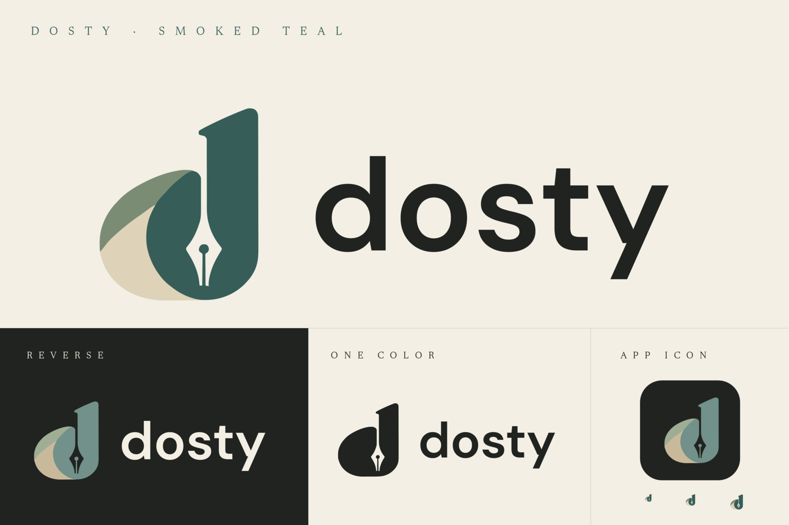

# dosty · smoked teal

Dosty pairs the selected curled-page **d**, a fountain pen in negative space,
and an outlined DM Sans wordmark. The smoked teal, sage, and parchment colors
share Moonlark Studios' charcoal/cream foundation. Use lowercase `dosty` in
artwork and **Dosty** in prose and application titles. The logo has no tagline.



## Assets

| Use | Asset |
| --- | --- |
| Default logo on light surfaces | [Horizontal signature](logos/lockup-horizontal.svg) |
| Dark surfaces | [Reverse signature](logos/lockup-horizontal-reverse.svg) |
| Symbol | [Curled page and pen](logos/pen-page.svg), [reverse](logos/pen-page-reverse.svg) |
| Name | [Outlined DM Sans wordmark](logos/wordmark.svg), [reverse](logos/wordmark-reverse.svg) |
| One color | [Ink](logos/lockup-horizontal-ink.svg), [cream](logos/lockup-horizontal-paper.svg) |
| Vertical placement | [Stacked signature](logos/lockup-stacked.svg), [reverse](logos/lockup-stacked-reverse.svg) |
| macOS | [ICNS](icons/dosty.icns), [unmasked square SVG](icons/dosty-square.svg) |
| Windows / favicon | [Multi-resolution ICO](icons/dosty.ico) |
| Linux / general icon | [Plated SVG](icons/dosty-plated.svg), [PNG sizes](icons/png) |
| Large artwork | [1024 px PNG](icons/dosty-1024.png) |

The SVGs contain self-contained paths, with no font or raster dependencies.
The PNG brand-sheet labels use bundled Newsreader; the wordmark always uses
its exact DM Sans outlines with nonzero winding, matching the native renderer. Documents retain Newsreader, controls use system
sans serif, and code uses system monospace.

## Approved form

The canonical [pen-page.svg](sources/pen-page.svg) is traced from the selected
[smoked teal mockup](sources/mockup-reference.png), preserving the curl,
slanted stem, pen counter, breather, slit, and original aspect ratio. Flat
fills replace the mockup's texture. [Reference metadata](sources/mark-reference.json)
records the original crop, checksum, normalization, and tracing method.
The [contour comparison](../../docs/validation/dosty-branding/mark-comparison.png)
shows the mockup, vector, and overlay at the reference size.

The [compact master](sources/pen-page-compact.svg) retains the same outer
contours and strengthens only the pen's breather and slit for 16–32 px exports.
Do not redraw or stretch the symbol when making variants. Native Iced paths,
logo SVGs, and platform icons are generated from these same masters.

[Wordmark source metadata](sources/wordmark-font.json) pins the original
DM Sans font, SHA-256, and axes: optical size 24 and weight 600 (Semibold).
DM Sans Semibold is the selected brand typeface. Horizontal signatures lower
the wordmark 16 units within the 256-unit mark height (2.5 px at the sidebar's
40 px size) to balance the main letter shapes with the symbol's lower bowl.
The SVG lockups and native paths share this optical alignment.
OpenType kerning is shaped with HarfBuzz in [outline-wordmark.py](outline-wordmark.py).
The original [font source](sources/DMSans-Variable.ttf) and
[SIL Open Font License](sources/DMSans-OFL.txt) are retained. Only reauthoring
the wordmark requires FontTools 4.61.1 and uharfbuzz 0.57.0; normal exports have no font-tool dependency.

Allow at least one quarter of the symbol height as clear space. Use the compact
symbol or supplied icons for small placements. Keep platform icons on the
fixed charcoal plate for recognition across application themes. macOS resources
have an opaque square with no baked-in mask; general PNGs and ICO use rounded
plates with transparent corners. No shadows are baked in.

## Palette and theme integration

[palette.json](palette.json) is the source of truth.

| Role | Light | Dark |
| --- | --- | --- |
| Field | Cream `#F3EFE4` | Charcoal `#20231F` |
| Wordmark | Charcoal `#20231F` | Cream `#F3EFE4` |
| Main body | Smoked teal `#365D58` | Muted teal `#71918A` |
| Upper curl | Sage `#7B8C75` | Sage `#9FAD94` |
| Page underside | Parchment `#DED2B8` | Parchment `#C9B99B` |

Inside the app, resolved `brand_ink`, `brand_accent`, and `brand_paper` semantic
colors adapt the mark to each theme; the wordmark uses `text`. Legacy custom
themes remain valid, falling back to `text`, `accent`, and `muted`. The pen
counter remains transparent. Decorative logo colors are not small-text colors.
See the [appearance system](../../docs/design-system.md).

## Reproduce

Requirements: Python 3.9+ standard library and ImageMagick 7 (`magick`).
Reference renderer: ImageMagick 7.1.2-31. Different renderer versions can change
raster bytes. Rebuilding the wordmark alone additionally needs FontTools 4.61.1 and
uharfbuzz 0.57.0.

```sh
python3 branding/dosty/export.py
python3 branding/dosty/export.py --check
python3 branding/dosty/export.py --output /tmp/dosty-brand-export
```

The exporter produces 41 derived assets: logo and icon SVGs, native paths,
16–1024 px PNGs, 16–256 px ICO frames, standard/Retina ICNS resources, and the
brand sheet. `--check` regenerates in a temporary directory and compares every
asset byte for byte, then verifies the canonical mark against the approved
reference silhouette. Inspect the brand sheet and icons at actual size after
modifying masters. PNG timestamp metadata is stripped.

The application loads its bundled icon before the UI event loop. The macOS
bundle is `target/Dosty.app`, executable `Dosty`, identifier `app.dosty.editor`.
Cargo's package and executable are `dosty`. Existing Koan/Daytrip settings,
sidecars, recovery files, and replica imports remain supported; see
[identity and compatibility](../../docs/identity-migration.md).

Artwork follows the repository's [GPLv3-or-later license](../../LICENSE).
DM Sans and Newsreader retain their separate SIL Open Font Licenses.
